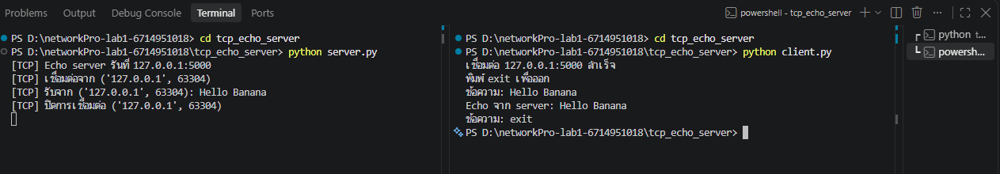
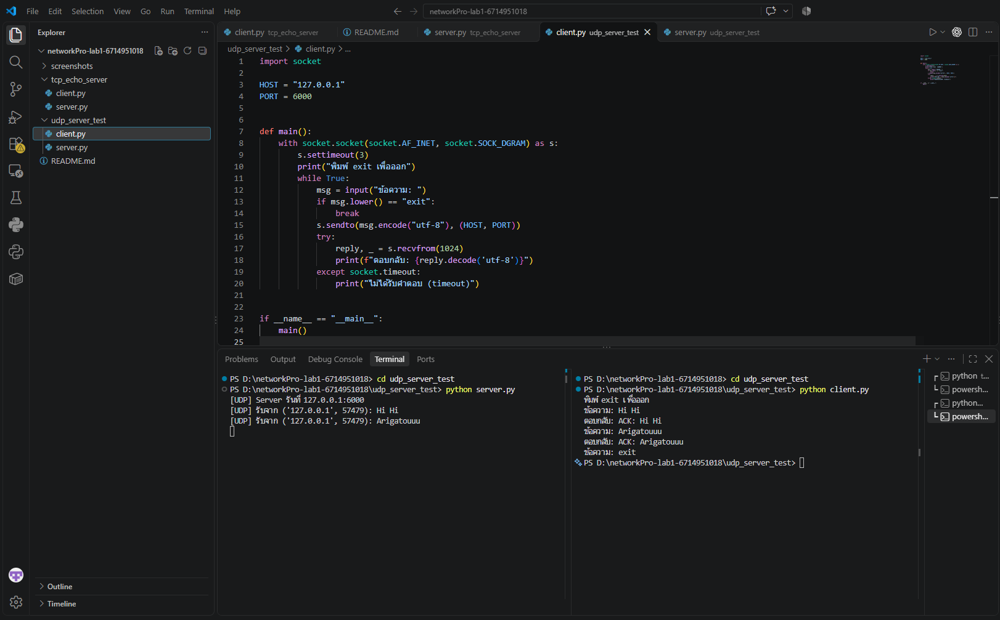

# networkPro-lab1-STUDENTID

**ชื่อ-สกุล:** ธัญรัตน์ พูนทอง  **รหัสนักศึกษา:** 6714951018
**รายวิชา:** Network Programming (CH1: Python Network)

## โครงสร้างโปรเจกต์
```
tcp_echo_server/   server.py, client.py
udp_server_test/   server.py, client.py
screenshots/       ภาพผลการทดสอบ
```

## วิธีรัน
**TCP** (เปิด 2 terminal)
```
cd tcp_echo_server
python server.py
python client.py
```
**UDP**
```
cd udp_server_test
python server.py
python client.py
```

## การออกแบบและเหตุผลที่เลือกเทคนิค
- ใช้โมดูล `socket` มาตรฐานของ Python ไม่ต้องติดตั้งเพิ่ม
- TCP (`SOCK_STREAM`): เชื่อมต่อแบบ connection-oriented ข้อมูลครบและเรียงลำดับ เหมาะกับ echo ที่ต้องการความถูกต้อง ใช้ thread เพื่อรองรับหลาย client
- UDP (`SOCK_DGRAM`): ไม่ต้องเชื่อมต่อ เร็วและเบา แต่ไม่รับประกันการส่งถึง จึงตั้ง `timeout` ฝั่ง client

## ผลการทดสอบ
### TCP

### UDP


## แหล่งอ้างอิง
- Python docs: https://docs.python.org/3/library/socket.html

